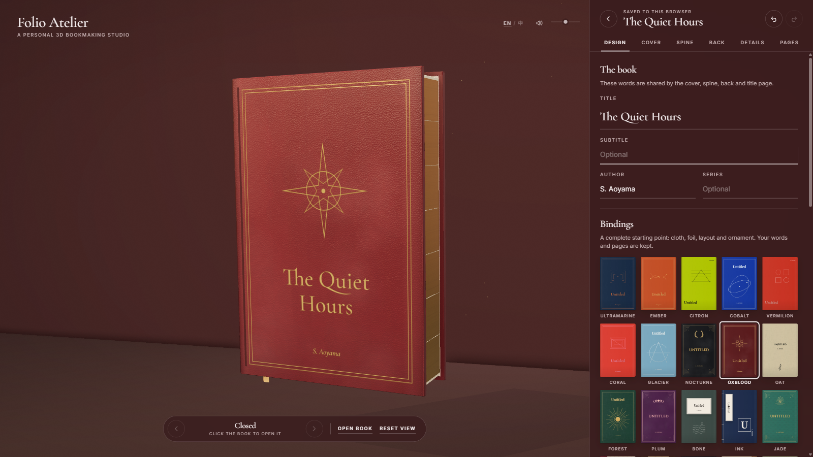
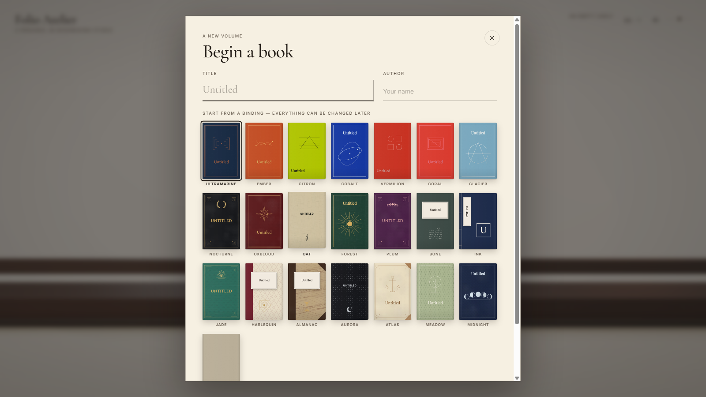
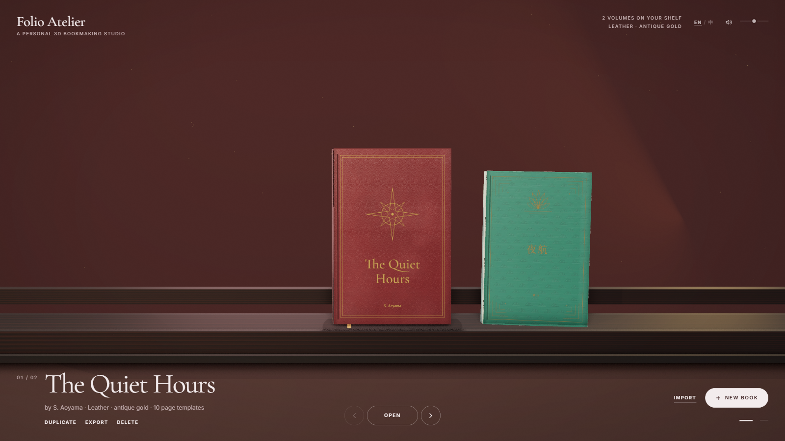
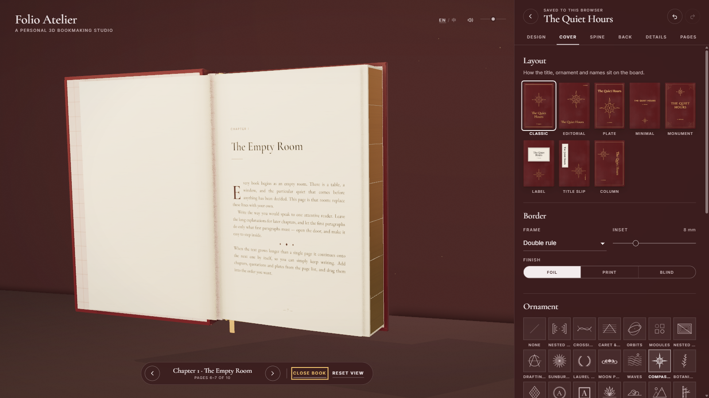
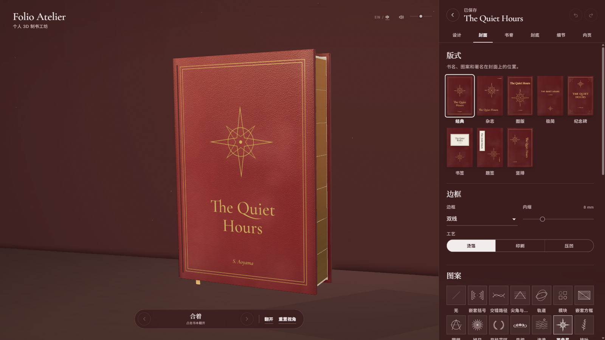
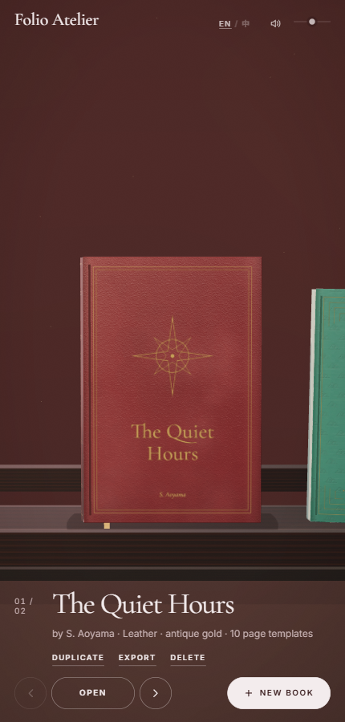

<!-- project:start -->
# Folio Atelier

A personal 3D bookmaking studio. Choose a cloth, press a title in foil, set the pages inside, then open the book and turn them — in English or Simplified Chinese.

**[Open the studio](https://seiya058904.github.io/Folio-Atelier/)** · [Source](https://github.com/seiya058904/Folio-Atelier)
<!-- project:end -->

<p align="center">
  <a href="https://seiya058904.github.io/Folio-Atelier/">
    
  </a>
</p>

<div align="center">

<h2>📖 Make a Book That Is Entirely Yours</h2>

<p><strong>Start from an empty shelf. Bind it. Letter it. Fill it. Open it.</strong></p>

<p>A real-time 3D studio where every book is a hardcover with curved page-turn physics,<br>
foil that catches the light, and typeset pages inside, kept on your own shelf in your browser.</p>

<p>
  <a href="https://seiya058904.github.io/Folio-Atelier/"><strong>▶ Enter the Studio</strong></a>
  &nbsp;·&nbsp;
  <a href="#the-binding">🧵 Binding</a>
  &nbsp;·&nbsp;
  <a href="#the-cover">🏷️ Cover</a>
  &nbsp;·&nbsp;
  <a href="#the-inside">📄 Inside</a>
  &nbsp;·&nbsp;
  <a href="#how-it-is-made">🛠️ How It Is Made</a>
</p>

<p><sub>3D HARDCOVERS &nbsp;·&nbsp; FOIL &amp; PATTERNS &nbsp;·&nbsp; REAL TYPESETTING &nbsp;·&nbsp; ENGLISH / SIMPLIFIED CHINESE &nbsp;·&nbsp; NO BUILD STEP</sub></p>

</div>

---

> **No account. No server. No install.**
>
> Folio Atelier is a single static page. Books save automatically to your browser, and any book can be exported as a `.folio` file to back it up or carry it elsewhere.

## 🪑 From an Empty Shelf

The first visit shows an empty walnut shelf and one invitation: create your first book. Pick one of twenty-two starting bindings; everything about it can be changed afterwards, and your words and pages are kept when you switch.

<table>
  <tr>
    <td width="50%" valign="top">
      
    </td>
    <td width="50%" valign="top">
      
    </td>
  </tr>
  <tr>
    <td valign="top"><sub><strong>Begin a book</strong> — title, author, and a binding to start from.</sub></td>
    <td valign="top"><sub><strong>Your shelf</strong> — orbit, duplicate, export, or open a volume.</sub></td>
  </tr>
</table>

<a id="the-binding"></a>
## 🧵 The Binding

<table>
  <tr>
    <td width="50%" valign="top">
      <h3>🧶 Nine Covering Materials</h3>
      <p><sub>BOOKCLOTH · BUCKRAM · LINEN · SILK · LEATHER · SUEDE · VELLUM · PAPER · VELVET</sub></p>
      <p>Full, quarter or half binding in two colours, each with its own grain, sheen and wear.</p>
    </td>
    <td width="50%" valign="top">
      <h3>✨ Sixteen Foils</h3>
      <p><sub>ANTIQUE GOLD · SILVER · COPPER · HOLOGRAPHIC · PEARL …</sub></p>
      <p>Adjustable metal, polish and iridescence. Foil is a true metallic layer, so it flashes as you orbit the book.</p>
    </td>
  </tr>
  <tr>
    <td width="50%" valign="top">
      <h3>🔶 Seventeen All-Over Patterns</h3>
      <p><sub>STRIPES · HARLEQUIN · WAVE SCALES · LINKED CIRCLES · FRET · CLOUDS · SPRIGS · MARBLING …</sub></p>
      <p>Stamped in foil, printed, or pressed blind, and optionally carried across the spine.</p>
    </td>
    <td width="50%" valign="top">
      <h3>🔩 Finishing Details</h3>
      <p><sub>EDGES · CORNERS · STITCHING · RIBBONS · HEADBANDS</sub></p>
      <p>Gilt, stained, sprinkled or ombré page edges; metal corner pieces; stab stitching in four or six holes; a pasted spine label; patterned endpapers; one or two ribbons; seven paper stocks.</p>
    </td>
  </tr>
</table>

<a id="the-cover"></a>
## 🏷️ The Cover, Spine and Back

Eight cover layouts (two set the title vertically), fourteen border styles and thirty-three ornaments. Bring your own artwork as a full cover or an inset plate, and add lettering lines with typeface, size, weight, tracking, position, direction and finish. Twenty-one typefaces are included, five of them Chinese. The spine and back are composed with the same tools.

<a id="the-inside"></a>
## 📄 The Inside

<table>
  <tr>
    <td width="58%" valign="top">
      
    </td>
    <td width="42%" valign="top">
      <h3>Write it, and it is typeset</h3>
      <p>Thirteen page templates: half-title, title page, dedication, epigraph, contents, part title, chapter opener, body text, verse, pull quote, plate, colophon and blank.</p>
      <p>Long text flows onto as many pages as it needs. The contents page builds itself, and <code>***</code> on its own line sets a section break.</p>
      <p>Choose leading, chapter-opening style, page-number position and ink colour. Latin and CJK text are both set properly.</p>
    </td>
  </tr>
</table>

## 🤲 Handle the Book

| Action | How |
| --- | --- |
| **Orbit and zoom** | Drag and scroll (or touch gestures) |
| **Open or close the cover** | Click the book, or **Open book** / **Close book** |
| **Turn pages** | Drag a page edge for curved page-turn physics, or use the arrows |
| **Jump the camera** | Front, spine, back, or the edges |
| **Undo / redo** | The arrows at the top of the studio panel |
| **Switch language** | **EN / 中** at the top of the page |

Each book also chooses the language of its own printed labels, so a book can say “Chapter I” or “第一章” whatever the interface language is.

<table>
  <tr>
    <td width="68%" valign="top">
      
    </td>
    <td width="32%" valign="top">
      
    </td>
  </tr>
  <tr>
    <td valign="top"><sub>Complete Simplified Chinese interface.</sub></td>
    <td valign="top"><sub>Phone layout.</sub></td>
  </tr>
</table>

## 📚 Keep a Library

Books save automatically in your browser (IndexedDB). Duplicate or delete a volume, **export** it to a `.folio` file and **import** it on another device or browser. Nothing is uploaded anywhere.

> [!NOTE]
> **Books live only in the browser that made them.** Clearing site data removes them. Export a `.folio` file to keep a copy.

<a id="how-it-is-made"></a>
## 🛠️ How It Is Made

No framework, bundler or backend: native ES modules, [Three.js](https://threejs.org/) 0.165 from a CDN, and IndexedDB for storage.

Each book is one serialisable `BookSpec`. The rig paints every surface from that spec onto canvases — a base layer for dyed material and print, and a white mask that the metallic foil material uses — so any edit repaints only the surfaces it touches while the model stays on screen. Only four leaves carry printed pages; as you read through a longer book, the leaf at the bottom of one pile is moved under the other and printed with the pages about to come into view.

<details>
<summary><strong>⚙️ Expand run-locally, module map &amp; rendering tiers</strong></summary>

### Run locally

The page uses JavaScript modules, so serve it over HTTP. There is nothing to install or build:

```bash
python -m http.server 4173
```

Then open <http://localhost:4173>. An internet connection is needed for the pinned Three.js modules and the web fonts. Force the language with `?lang=en` or `?lang=zh`.

### Module map

| Path | Responsibility |
| --- | --- |
| [`index.html`](index.html) | Page shell and the Three.js import map |
| [`styles/app.css`](styles/app.css) | Interface styling |
| [`src/main.js`](src/main.js) | Start-up; connects store, engine and interface |
| [`src/engine.js`](src/engine.js) | Room, shelf, cameras, shelf ⇄ studio state machine, page interaction |
| [`src/book/rig.js`](src/book/rig.js) | The hardcover: boards, rounded spine, hinges, leaves, edges, foil layers |
| [`src/scene/quality.js`](src/scene/quality.js) | Rendering tiers |
| [`src/textures/`](src/textures/) | Procedural painters: materials, covers, patterns, ornaments, typesetting, pages |
| [`src/state/`](src/state/) | `BookSpec` schema, store with undo, IndexedDB, images |
| [`src/data/`](src/data/) | Starting bindings and typefaces |
| [`src/ui/`](src/ui/) | Shelf interface, studio workbench, controls |
| [`src/i18n.js`](src/i18n.js) | English / Simplified Chinese interface strings |
| [`src/audio.js`](src/audio.js) | Music and interaction sounds |

### Rendering quality

Three tiers, chosen from the device and stepped down automatically if the first seconds run below about 30 fps. Force one with `?quality=high`, `?quality=balanced` or `?quality=lite`.

| Tier | Textures | Shadows | Extras |
| --- | --- | --- | --- |
| `high` | 2× covers and pages | 4096 | Ambient occlusion, 4× MSAA, page-turn shadows |
| `balanced` | 1.5× | 2048 | Page-turn shadows |
| `lite` | 1× | 1024 | — |

Bloom and depth of field were tried and removed: both softened printed text.

### Deployment

The [Pages workflow](.github/workflows/pages.yml) syntax-checks every module, assembles `index.html`, `src/`, `styles/` and `assets/` into a static site, and deploys it from `main`.

</details>

## 📜 Origin & Credits

Folio Atelier is a remix of **[The Complete Shelf](https://github.com/mengto/complete-shelf) by Meng To**. The hardcover construction, page-turn physics, shelf-to-detail transitions, room and lighting, walnut texture, soundtrack and Foley come from that project. Its seven bindings live on here as de-branded colour, foil and ornament presets; the original cover artwork and product names are not included.

New in this remix: the bookmaking studio and `BookSpec` model, materials, foils, patterns, ornaments, typesetting for Latin and CJK text, the page-template system, the `.folio` library, undo/redo, the Simplified Chinese interface, and rendering tiers.

> [!NOTE]
> The original repository carries no licence file, but its README openly invites readers to **build or remix it** with a coding agent, and this project follows that invitation. Folio Atelier keeps full credit to the original, leaves out its brand-themed cover artwork and product names, and does not claim the original's work as its own. If the original author ever asks for a change, it will be made.

---

<p align="center">
  <sub>CHOOSE A CLOTH. PRESS A TITLE. TURN THE PAGE.</sub><br>
  <sub>Folio Atelier · A small studio for one-of-a-kind books.</sub>
</p>
